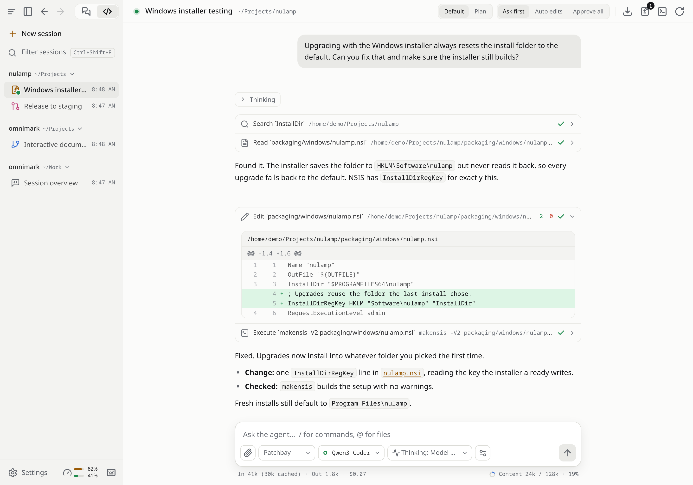

# Patchbay

**One desktop app for chatting and coding with any AI model.**

Patchbay is a desktop app in the style of Claude Desktop. Bring your own provider: OpenAI, Anthropic, OpenRouter, a local model in Ollama or LM Studio, or any endpoint that speaks the OpenAI or Anthropic API. Conversations are saved on your computer, not in someone else's cloud.

<picture>
  <source media="(prefers-color-scheme: dark)" srcset="docs/images/code-tab-dark.png">
  
</picture>

> **Early days.** Patchbay is young and still has rough edges. [Download the latest release](https://github.com/jpsutton/patchbay/releases/latest), and please report what breaks.

## What it does

### Chat

- Streaming replies with Markdown, code highlighting, math and Mermaid diagrams.
- Attach images, PDFs and text files.
- Edit a message or regenerate a reply, then flip between versions with ‹ ›.
- Custom system prompts per conversation, with a library of saved prompts.
- See the model's reasoning, and dial its thinking effort up or down per message.
- Export any conversation as Markdown or JSON.

### Code

- Point an AI agent at a project folder and let it read, edit and run things, with you in the loop.
- Approve or deny each action inline, or tell it "always allow" for that folder.
- Review every changed file as a diff, and use the built-in terminal.
- Type `/` for the agent's commands and `@` to mention files.
- Add MCP servers in Settings to give the agent more tools.

### Everywhere

- **Ctrl+K** (⌘K on macOS) searches every chat and session and runs commands. **Ctrl+/** lists all shortcuts.
- Pin chats and sessions, filter them by title, and browse them by date.
- A tray icon, notifications when a reply finishes in the background, and an optional global shortcut for quick questions.
- **Settings → Usage** shows what you've spent and how many tokens you've used, per day and per model.

### Across your computers

- Link your computers into a **mesh** (Settings → Mesh). Chats, Code sessions, prompts, providers and MCP servers sync between them live, API keys included, encrypted.
- Drive a Code session running on another computer from this one, or move it over, uncommitted changes and all. If that computer goes offline, take the session over from its last checkpoint.
- Computers connect directly over a network you already have, such as Tailscale, ZeroTier, a VPN or a Cloudflare Tunnel. No cloud service sits in the middle, and every new computer needs the mesh's passphrase plus your approval.
- **Patchbay Remote**, the Android app, follows and drives your computers' chats and Code sessions from your phone, without holding your API keys. Install it from Patchbay's own F-Droid repository.

See [docs/mesh.md](docs/mesh.md) for setup and details.

## Getting started

1. Open **Settings** and add a provider. Presets cover OpenAI, Anthropic, OpenRouter, Ollama and LM Studio.
2. Fetch the provider's model list (or type model names), and pick a default model.
3. Start a chat, or open the **Code** tab and choose a project folder.

API keys are kept in your system's keychain, never in a plain file.

## Installing

Download Patchbay from the [Releases page](https://github.com/jpsutton/patchbay/releases/latest). Packages are available for:

| Platform | Packages |
| --- | --- |
| Linux | `.deb` (Ubuntu 24.04 or newer, Debian 13), `.rpm` (Fedora, openSUSE), AppImage, and an Arch Linux package repository. Needs glibc 2.39 or newer. |
| Windows | Installer (`.exe`) and `.msi` |
| macOS | `.dmg` (Apple silicon) |

Windows and macOS builds aren't signed by Microsoft or Apple yet, so your system will warn you the first time you open them.

### macOS

The easiest way to install or update is the install script. It downloads the latest `.dmg`, checks it against the release's `SHA256SUMS`, and copies Patchbay into `/Applications`:

```sh
curl -fsSL https://raw.githubusercontent.com/jpsutton/patchbay/release/scripts/install-macos.sh | bash
```

Files downloaded with `curl` aren't quarantined, so Patchbay opens without a Gatekeeper prompt. Run the same command again to update.

If you download the `.dmg` in a browser instead, macOS says Apple could not verify that Patchbay is free of malware. After the first attempt to open it, go to **System Settings › Privacy & Security** and click **Open Anyway**. Or clear the quarantine from a terminal:

```sh
xattr -dr com.apple.quarantine /Applications/Patchbay.app
```

For a computer without a display, `patchbayd` runs Patchbay headless and serves the same UI to a browser. It comes in the same formats (`.deb`, `.rpm`, the Arch repository, plus archives for any Linux, Windows and macOS), with systemd units on Linux. See [docs/headless.md](docs/headless.md).

### Arch Linux

Add the signed package repository to `/etc/pacman.conf`:

```ini
[patchbay]
Server = https://github.com/jpsutton/patchbay/releases/latest/download
```

Then trust the release key and install:

```bash
curl -fsSL https://raw.githubusercontent.com/jpsutton/patchbay/staging/packaging/patchbay-signing-key.asc | sudo pacman-key --add -
```

```bash
sudo pacman-key --lsign-key 0D3A064DDF8B635FD85894E9B3A7618B4B88E5D7
```

```bash
sudo pacman -Sy patchbay
```

### Checking a download

Every release file comes with a signature, and the release includes a signed `SHA256SUMS`. The release key is [`packaging/patchbay-signing-key.asc`](packaging/patchbay-signing-key.asc), fingerprint `0D3A 064D DF8B 635F D858  94E9 B3A7 618B 4B88 E5D7`.

```bash
gpg --import patchbay-signing-key.asc
```

```bash
gpg --verify SHA256SUMS.sig SHA256SUMS && sha256sum --check --ignore-missing SHA256SUMS
```

## Building from source

You need Rust, Node.js 20 or newer with pnpm, and `protoc` (the Protocol Buffers compiler). On Linux you also need the [Tauri system packages](https://v2.tauri.app/start/prerequisites/), including WebKitGTK 4.1.

```bash
git clone --recurse-submodules https://github.com/jpsutton/patchbay.git
```

```bash
cd patchbay && pnpm install && PROFILE=release scripts/build-sidecar.sh && pnpm tauri build
```

The first build compiles the coding agent and takes several minutes. The finished app and installers land in `src-tauri/target/release/bundle/`.

To work on Patchbay itself, see [docs/DEVELOPMENT.md](docs/DEVELOPMENT.md).

## How it works

Patchbay's built-in coding agent is [Grok Build](https://github.com/xai-org/grok-build), the open-source agent from xAI, with a few small fixes so it works with any provider. Patchbay turns off its telemetry and auto-updates.

Patchbay talks to coding agents over the [Agent Client Protocol](https://agentclientprotocol.com), an open standard. So a Code session can also run an agent you already have installed and signed in to:

- [Claude Code](https://claude.com/claude-code), through the [Claude Agent ACP adapter](https://github.com/agentclientprotocol/claude-agent-acp). Patchbay runs the adapter with `npx` when it isn't installed.
- [OpenCode](https://opencode.ai)
- [Cursor CLI](https://cursor.com/cli)
- [Kilo Code](https://kilo.ai) CLI

These agents use their own sign-in and model list. Pick the default agent in Settings → Coding agents.

## Known limitations

- Only Anthropic models read PDFs directly. Other models get the PDF's text, or page images when a page has no text.
- Chat can't use tools yet, so MCP servers only work in the Code tab.
- On Wayland, the global shortcut may not work. The tray icon on Linux needs a desktop that supports tray icons (StatusNotifier).
- No auto-update yet, and no support for Office files (Word, Excel, PowerPoint).

## License

Patchbay is licensed under the [Apache License 2.0](LICENSE). It includes Grok Build (Apache-2.0, © SpaceXAI) and other open-source components; see [NOTICE](NOTICE) and [THIRD_PARTY_NOTICES.md](THIRD_PARTY_NOTICES.md).
